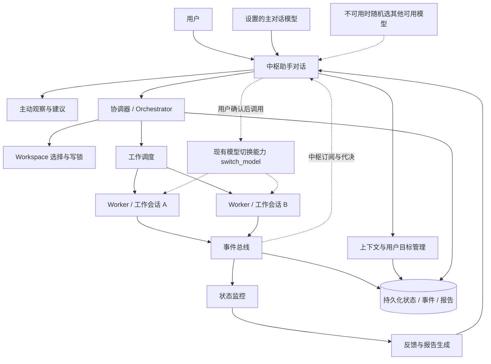

# 天工「中枢模式」设计稿（草案）

> 状态：**设计定稿，已进入开发准备**。基础分支 `develop/central-mode`；阶段划分见 §17，开放问题见 §18。
> 创建日期：2026-11-04
> 修订：2026-11-06 补充模型可用性与接力（15.8～15.13）：自动切换、告知但不打断只属于中枢，工作会话直接复用现有切换能力；中枢暂时直接用设置中的主对话模型，不可用时随机选取其他可用模型；所有需要用户决定的事项默认由中枢直接处理，不逐条转嫁给用户。
> 修订：2026-11-06 设计定稿并建立开发基础分支 `develop/central-mode`；阶段 0 概念确认完成，自阶段 1 起进入实现，分阶段跟踪见仓库 Issue（链接见 `PLAN.md`）。
> 文档定位：只描述目标体验、边界、架构方向和待决问题；不把本方案写成已确认需求，也不替代后续 RFC / 实施设计。
> 约定：下文用“中枢助手”指用户面对的超级智能助手，用“工作会话 / Worker”指后台实际执行工作的会话或 Subagent。

---

## 0. 修订要点：为什么不是“任务中心”

早期表述容易把本模式理解成“任务管理面板”，这会削弱超级助手感。本设计稿采用以下定位：

> **以助手为入口，以用户目标为语义核心，以任务为后台执行机制。**

需要区分三个层次：

| 层次 | 核心对象 | 用户是否直接感知 | 说明 |
| --- | --- | --- | --- |
| 用户关系层 | 中枢助手 | 强感知 | 一个持续存在、理解上下文、主动观察、能协调后台工作的智能伙伴 |
| 意图与目标层 | 用户想达成什么 | 强感知 | 用户自然语言表达的目标、约束、优先级、当前关注点 |
| 执行层 | 任务、子任务、Workspace、工作会话、事件 | 弱感知 | 系统用于可靠执行、追踪、验证和汇报的内部机制 |

因此：

- 用户默认不是“创建任务”，而是“告诉天工想完成什么”；
- 用户默认不面对 Session 列表和任务看板，而面对一个持续对话；
- 后台仍然必须有任务、事件和状态机，否则多 Workspace、多 Agent、失败恢复和可靠反馈无法成立；
- 任务不应成为产品的第一层交互对象，只应在用户主动要求或发生异常时按需展开。

一句话总结：

> **天工中枢不是任务管理器，而是一个持续观察用户工作、理解用户意图、协调后台执行并在关键时刻反馈的个人超级助手。**

---

## 1. 背景与产品动机

当前天工以会话列表和单会话工作区为主要导航形态。用户需要感知“我在哪个会话中工作”、手动切换会话，并在会话内与 Agent 协作。

这对明确、局部、一次性的任务有效，但不完全符合一种更自然的想象：

> 用户面前始终只有一个智能助手。用户不需要关心它背后开了多少会话、用了多少 Agent、切换了哪个 Workspace；只需要表达目标，助手自行理解、安排、观察、协调，并在合适时机主动汇报。

这个体验更接近一个持续在场的个人超级助手：

- 持续在场；
- 理解上下文；
- 能主动提醒；
- 能协调后台能力；
- 不把内部工作机制暴露给用户；
- 用户以自然语言与它交流；
- 它可靠地反馈“发生了什么、完成了什么、还需要什么决定”。

但工程上必须避免把“像超级助手”误做成“一个什么都能直接做的大 Agent”。本方案的关键边界是：

> **中枢助手是控制面和交互面，不直接执行具体工作；具体工作由绑定到 Workspace 的后台工作会话或 Agent 完成。**

---

## 2. 目标、非目标与成功标准

### 2.1 产品目标

1. 提供一个新的桌面交互模式：隐藏左侧 Session 列表，进入单一中枢对话。
2. 建立一个长期存在的中枢助手身份，承载问候、上下文理解、主动建议、任务协调和结果汇报。
3. 用户只表达目标，不主动管理后台会话、Agent 和任务。
4. 中枢助手可针对某个或多个 Workspace 发起、恢复或协调工作会话。
5. 中枢助手不直接修改文件、执行命令或完成具体工作。
6. 工作会话通过事件把开始、进展、阻塞、审批、完成和失败反馈给中枢助手。
7. 中枢助手根据反馈策略，向用户发送单条即时反馈或阶段性汇总报告。
8. 用户激活天工时，中枢助手可主动问候，并基于上下文猜测用户可能要进行的工作，给出合适建议。
9. 保留可追溯性：需要时用户可以查看后台工作状态、原始工作会话、验证证据和报告。
10. 工作会话的默认模型不可用时，中枢助手与用户商量后，直接调用现有模型切换能力完成接力；不为工作会话另建切换机制。
11. 中枢对话自身始终保持可用：工作会话模型故障或切换不得让用户无法与助手交流。
12. 工作会话产生的待决事项默认由中枢助手直接处理，用户只面对中枢确实无法代决的少数决定。

### 2.2 非目标

第一阶段或非核心范围内暂不要求：

- 不做拟人化语音、全息界面或电影式视觉拟真；
- 不让中枢助手直接执行任何工具型工作；
- 不删除现有 Session 体系，不破坏普通模式；
- 不把本模式设计成通用项目管理系统；
- 不默认让模型凭推测自动执行高风险操作；
- 不在首期引入外部日历、邮件、生产环境发布等高风险集成；
- 不以“任务列表是否丰富”作为体验成功标准。

### 2.3 成功标准

本设计进入实现阶段前，至少应能用以下问题验证方向是否正确：

1. 用户是否能只用一个对话入口完成跨 Workspace 的目标表达？
2. 用户是否不必理解 Session、Subagent、Task ID 等内部概念？
3. 中枢助手是否始终不直接执行文件或命令类工作？
4. 后台任务完成时，用户是否能收到基于真实事件和验证证据的反馈？
5. 用户离开再回来后，中枢助手是否能准确汇报期间发生的变化？
6. 主动建议是否能说明依据，并且不会演变成频繁打扰？
7. 同一 Workspace 的并发修改是否受控？
8. 高风险操作是否仍然由用户掌握最后确认权？
9. 用户能否随时从“助手视图”深入到底层工作视图进行复核？
10. 关闭中枢模式后，普通模式与既有会话是否不受影响？
11. 默认模型不可用时，用户是否能在中枢对话里被清楚询问，并自主选定接力模型或选择挂起？
12. 任一工作会话模型不可用、切换失败或中枢自身降级时，中枢对话是否仍能回应、展示状态并征求决定？
13. 工作会话产生待决事项时，用户是否只被问到中枢确实无法代决的少数决定，且每次最多一个？

---

## 3. 核心概念与术语

| 术语 | 定义 | 用户可见程度 |
| --- | --- | --- |
| 中枢模式 | 隐藏左侧 Session 列表、以单一助手对话为入口的桌面模式 | 可见，产品模式名 |
| 中枢助手 | 用户持续对话的超级助手，负责理解、协调、观察、汇报 | 强可见 |
| 用户目标 | 用户用自然语言表达的意图及约束，是用户侧语义核心 | 强可见 |
| 关注事项 | 助手认为当前值得用户知道的进行中事项，用户侧对后台任务的轻表达 | 弱可见 |
| 后台工作 | 系统内部对执行单元的总称，不要求用户直接操作 | 按需可见 |
| Task / Subtask | 执行层数据结构，用于调度、状态、依赖和验证 | 默认隐藏 |
| Workspace | 任务绑定的工作区，包含路径、能力和权限边界 | 按需可见 |
| 工作会话 / Worker | 实际执行任务的会话、Subagent 或后台 Agent | 默认隐藏，复核时可见 |
| 事件 | 工作会话产生的结构化状态变化 | 默认隐藏 |
| 报告 | 中枢助手基于事件、证据和产物生成的用户可读汇总 | 可见 |
| 中枢模型 | 中枢对话当前使用的模型；暂时就是设置中的主对话模型，不单独绑定 | 设置中可见 |
| 工作模型 | 某个工作会话 / Worker 绑定的执行面模型 | 按需可见 |
| 模型接力 | 默认模型不可用时，中枢与用户商量后调用现有 `switch_model` 改用另一模型继续工作；不是新的切换机制 | 可见 |
| 降级模式 | 设置中的主对话模型不可用时，临时随机改用其他可用模型并告知用户的状态标记；不等于能力下降 | 可见（状态提示） |
| 中枢代决 | 中枢助手基于用户目标、约束、偏好与风险分级，替工作会话处理待决事项并回传结果 | 汇报中可见，默认不打扰 |

---

## 4. 总体体验

### 4.1 进入与退出模式

进入方式候选：

- 顶部模式切换；
- 快捷键，如 `Cmd/Ctrl + Shift + J`；
- 设置中指定启动默认进入；
- 未来可由全局唤醒入口进入。

进入后：

- 左侧 Session 列表隐藏；
- 主区域呈现单一中枢对话；
- 顶部保留模式、轻量状态和设置入口；
- 原 Session 和 Workspace 不清空、不迁移、不删除；
- 普通模式仍可从设置或模式切换恢复。

退出后：

- 正在运行的后台工作不因切换 UI 模式而取消；
- 中枢对话和任务状态持久化；
- 用户再次进入时恢复上下文和未确认反馈。

### 4.2 激活问候

激活时不使用固定欢迎语，而是基于当前可验证上下文生成简短问候。

可用上下文：

- 当前时间；
- 最近使用 Workspace；
- 正在运行或等待确认的后台工作；
- 最近完成、失败、阻塞的事项；
- 用户此前明确表达的目标；
- 用户设置的反馈频率和建议偏好。

示例：

> 早上好，Hubert。
> 你离开期间有 3 个事项发生变化：支付服务分析已完成，桌面客户端构建仍失败，另有一个数据库迁移方案等待你确认。
> 如果你今天继续处理客户端问题，我建议先看构建失败报告。

没有上下文时：

> 你好，我是天工中枢。
> 你可以直接告诉我目标，我会判断需要哪个 Workspace、安排后台工作、跟踪进展，并在关键节点向你汇报。

约束：

- 问候必须简洁；
- 不把推测写成事实；
- **实现态（2026-11-12）**：激活问候已落地——进入中枢模式时系统注入
  `[系统中枢][激活]` 状态摘要（等待决策/失败/中断/在跑/暂停/排队/目标，
  经 build_activation_summary 组装可验证事实），驱动中枢主动开 turn
  问候；幂等（每进程首次，§10.4 频率控制）；空闲态给能力介绍指引；
  人设「激活问候」段承载本节约束；
- 不一次罗列过多信息；
- 建议最多 1～3 条；
- 明确区分“我发现”“我推测”“我建议”“已完成”。

### 4.3 用户表达目标

用户不需要选择 Session，不需要创建任务，不需要指定 Agent。

例如：

> 帮我看看支付服务最近为什么这么慢。

中枢助手内部判断：

- 这是只读分析还是修复请求；
- 目标 Workspace 是否明确；
- 是否存在多个候选 Workspace；
- 是否需要拆分后台工作；
- 是否存在并发写入冲突；
- 风险级别是否允许自动安排；
- 哪些结果值得向用户汇报。

用户可能看到的回复：

> 我会先安排一次只读分析，不修改代码。主要看最近的超时日志、请求链路和慢查询；如果找到明确原因，我再给你修复建议。

这里用户感受到的是“我交代给了一个能干活的助手”，而不是“我提交了一个任务”。

### 4.4 助手视图与工作视图

#### 默认：助手视图

- 全屏对话；
- 问候；
- 当前上下文；
- 主动建议；
- 重要进展；
- 阻塞询问；
- 完成或失败报告；
- 关键节点的征询卡片（由 `interaction` 插件提供，一次一张）；
- 一个轻量的“查看后台工作”入口。

示意：

```text
┌─────────────────────────────────────────────┐
│ 天工中枢                    [后台状态] [设置] │
├─────────────────────────────────────────────┤
│                                             │
│ 早上好，Hubert。                             │
│                                             │
│ 昨天你提到支付服务响应变慢。                 │
│ 我观察到 payment-service 最近有 3 次超时错误，│
│ 已经准备好一份初步分析。                     │
│                                             │
│ 另外，client-app 的构建仍然失败。             │
│ 要我先处理支付超时，还是先修复构建问题？       │
│                                             │
│                         [查看后台工作]        │
├─────────────────────────────────────────────┤
│ 你想让我做什么？                       [发送] │
└─────────────────────────────────────────────┘
```

征询卡片出现时会覆盖并锁定输入区，回答或关闭后恢复；它不改变「单一对话」形态，也不需要切换到其他会话。

#### 按需：工作视图

用户点击“查看后台工作”或发生阻塞时再进入：

- 正在处理的事项；
- 子工作与依赖；
- Workspace；
- 工作会话 / Agent；
- 事件时间线；
- 验证命令和结果；
- 产物；
- 原始 Session 入口；
- 暂停、恢复、取消、要求汇报等控制。

工作视图是抽屉、侧边面板或详情页，不恢复成左侧 Session 列表，也不应成为主导航。

---

## 5. 中枢助手的职责边界

这是本设计最重要的工程约束。

### 5.1 允许的能力

中枢助手可以：

- 读取中枢对话和长期偏好；
- 读取用户目标、关注事项和后台状态摘要；
- 读取 Workspace 基础信息和能力；
- 选择或建议 Workspace；
- 创建、拆分、暂停、恢复、取消后台工作；
- 创建或唤醒工作会话；
- 向工作会话发送补充指令；
- 订阅任务事件；
- 请求用户审批或补充信息；
- 代工作会话处理待决事项：基于用户目标、约束、偏好与风险分级直接作出判断并回传；
- 把中枢代决的依据与结果写入汇报和审计记录；
- 生成用户可读的即时反馈和汇总报告；
- 根据失败事件重新规划或建议下一步；
- 发送系统通知或 Bot 推送；
- 读取模型注册表与现有错误分类，判断默认模型为何不可用；
- 在工作会话默认模型不可用时，向用户发起模型接力协商；
- 在用户确认后，对工作会话调用现有模型切换能力并恢复工作；
- 读取中枢模型降级状态，并在降级时按最小能力集回应。

### 5.2 禁止直接执行的能力

中枢助手本身不应直接：

- 读写或修改用户项目文件；
- 执行 Shell 命令；
- 操作数据库；
- 修改代码；
- 安装依赖；
- 创建 Git 提交；
- 删除文件；
- 发布、部署或迁移生产数据；
- 发送外部消息；
- 操作桌面应用或浏览器完成具体工作；
- 伪造验证结果或声称任务完成；
- 未经用户确认静默替换工作会话的默认模型，或把用户沉默当作同意（中枢自身的临时兜底切换不受此限，见 15.12）；
- 把模型不可用误报为工作失败、工作完成，或用推测的原因替代判定依据；
- 把工作会话的每个待决事项原样转成用户征询，或用多张卡片反复打断用户；
- 在超出授权、无明确依据或改变用户目标时替用户作决定。

### 5.3 权限隔离建议

不应只靠提示词约束，应由宿主在工具路由层建立独立白名单：

```text
中枢助手工具集（POC 实现态，22 个——与 central-plugin tool_specs 逐一对应，
由 `central_tool_specs_equal_handlers` 测试锁定双向一致）：
- get_context / list_workspaces / inspect_workspace / list_models / list_sessions
- dispatch_work（含 session_id 复用、after_work_id 排队、parallel 写入锁豁免）
- send_to_worker / collect_work_reports / list_work_items / search_history
- cancel_work / pause_work / resume_work / get_work_timeline / get_work_item_status
- create_goal / update_goal_status / create_report / list_reports
- switch_worker_model / send_notification / confirm_workspace
（request_user 按用户裁决暂缓——中枢需要用户决策时在对话文本中直接询问）

工作会话工具集：
- fs
- terminal
- command
- browser
- computer-use
- database
- coding
- test_runner
- plugin-specific tools
```

判断原则：

> 中枢助手可以“安排一次测试”，但不能“自己运行测试”；可以“读取测试已经通过的事件”，但不能“替 Worker 说测试通过”。

`list_model_profiles` 与 `get_model_status` 只读取现有端点配置、凭据状态和统一错误分类，不构成独立的可用性探测子系统。`switch_worker_model` 只是对现有 `TiangongCore::switch_model` 的一次带用户确认票据的调用，沿用其全部语义，不新增 Worker 侧模型管理能力；权限网关校验确认票据，防止绕过商量直接换模型。中枢自身的临时兜底切换由宿主控制面自动执行，不列入中枢助手工具集（见 15.12）。

`request_user` 由现有 `interaction` 插件提供，中枢只在少数关键节点使用（见 5.4）；工作会话不调用它。由于只有中枢对话会发起用户征询，`session_id` 天然就是当前唯一激活会话，不需要改造插件、宿主会话过滤或引入征询队列。

### 5.4 待决事项默认由中枢处理

工作会话不面向用户。Worker 执行中产生的「需要决定」——审批、确认、选择、补充信息、等待资源——一律作为事件上报（`approval.required`、`work_item.waiting_user` 等），**不直接调用 `request_user`，也不逐条转给用户**。

中枢助手基于以下输入直接作出判断并把结果回传给 Worker：

- 用户已表达的目标、约束和完成标准；
- 用户既有偏好与预设授权；
- 风险分级（见 14.1）；
- Workspace 状态、事件证据和已完成阶段；
- 当前后台工作的依赖与优先级。

可以代决：候选择取、缩小范围、等待资源、排队与改派、重试边界、按预设偏好排列接力候选等不改变用户目标、不越出授权、有明确依据的事项。**模型接力本身不在代决范围内**：偏好只影响候选排序，选哪个模型仍要用户确认（见 15.10、14.1）。

必须问用户：高风险操作（删除、发布、生产迁移、外部消息、付费、权限变化）、改变用户目标或完成标准、无明确依据的判断、用户明确要求「必须我确认」的事项，以及模型接力（见 15.10）。模型接力是中枢检测到模型故障后主动发起的协商，不属于 Worker 上报的待决项。

用户负担控制：

- 同类待决合并，一次最多向用户提出一个决定；
- 询问由中枢以自己的名义在**中枢对话**里发起，说明「我已经替你处理了什么、还剩什么需要你定」；
- 能从中枢对话上下文推断的，不弹表单、不重复收集；
- 用户未回复、超时或关闭时不当作同意，保持等待但不反复打扰；用户回来时一次性汇报已代决事项，仍未回答的必问决定继续按「一次一个」依次提出；
- 反馈策略为「安静」时，只有必须问用户的事项才出现。

调用契约（沿用现有 `interaction` 插件，不自造通道）：`request_user` 必须独占一个工具调用批次，不能与派发工作、切换模型或生成报告同时调用；只有 `answered` 且用户明确选定才继续后续动作，`expired` / `cancelled` / 失败结果一律保持等待、不当作同意；该插件仅 Desktop 可用，若未来支持 CLI / Server / Bot 入口需另设征询通道（见开放问题 13）。

可复核：每次代决都要记录依据、决定、影响范围、时间和回传对象；汇总报告列出代决清单（见 9.2、14.3），用户可随时追问或撤销。

因为工作会话不产生用户征询，`request_user` 的 `session_id` 天然就是当前唯一激活的中枢对话；**不需要改造 `interaction` 插件、宿主会话过滤，也不需要征询队列**。这既减轻用户负担，也让实现范围保持最小。

---

## 6. Workspace 选择与绑定

### 6.1 选择优先级

1. 用户当前明确指定的 Workspace；
2. 当前激活或最近使用的 Workspace；
3. 用户输入中出现的路径、项目名或模块名；
4. Workspace 描述、README、Git remote、文件索引匹配；
5. 最近处理过同类问题的 Workspace；
6. 多个候选时请求用户选择或提出拆分建议。

示例：

> 你说的“支付模块”在 `shop-backend` 和 `shop-web` 中都存在。
> 我建议先只读分析后端接口和数据库链路；如果你希望连前端支付页一起处理，我也可以拆成两个后台工作。

### 6.2 绑定信息

每个后台工作至少应记录：

```text
work_item
├── id
├── conversation_id
├── user_goal_id
├── parent_work_item_id
├── workspace_id
├── workspace_path
├── worker_session_id
├── worker_agent_id
├── status
├── risk_level
├── write_lock
├── created_at
├── updated_at
└── completion_criteria
```

这保证：

- 用户虽然看不到 Session 列表，后台仍能准确归属；
- 报告可以追溯验证证据；
- Workspace 并发写入可控；
- 中枢助手重启后能恢复状态；
- 用户可从报告进入原始工作会话。

### 6.3 冲突保护

建议默认策略：

- 同一 Workspace 同一时间最多一个写入型工作；
- 只读分析可并行；
- 多个写入工作按目标优先级排队；
- 用户可显式允许并行，但必须提示冲突风险；
- 排队状态应能被中枢助手解释为自然语言，而不是暴露锁细节。

用户侧表达：

> 我先让 `payment-service` 完成当前修复，再安排新的代码修改；同时可以继续做不修改文件的日志分析。

---

## 7. 用户目标与后台工作的映射

用户侧不创建“任务”，系统内部仍需要结构化执行计划。

### 7.1 目标表达

用户目标可包含：

- 标题；
- 自然语言描述；
- 约束；
- 完成标准；
- 优先级；
- 风险级别；
- 相关 Workspace；
- 是否允许自动安排；
- 是否需要用户确认计划；
- 反馈偏好。

示例：

```json
{
  "title": "排查支付服务响应变慢",
  "description": "用户希望了解最近支付服务响应变慢的原因，并在发现明确问题时得到修复建议",
  "constraints": ["首轮不修改代码", "优先使用已有日志和测试"],
  "completion_criteria": ["形成原因分析", "给出可复核证据", "如有明确修复方案则说明风险"],
  "risk_level": "low",
  "auto_dispatch": true
}
```

### 7.2 后台工作计划

```json
{
  "goal_id": "goal_xxx",
  "work_items": [
    {
      "title": "检查最近超时日志",
      "type": "analysis",
      "workspace": "payment-service",
      "depends_on": []
    },
    {
      "title": "检查数据库慢查询",
      "type": "analysis",
      "workspace": "payment-service",
      "depends_on": []
    },
    {
      "title": "形成原因分析与修复建议",
      "type": "synthesis",
      "depends_on": ["检查最近超时日志", "检查数据库慢查询"]
    }
  ]
}
```

“合成 / 汇总”是否由中枢助手自己完成需要进一步界定：如果它只基于事件和报告做语言组织，不调用工作型工具，可以视为控制面能力；如果需要读取文件、运行分析工具，则仍应由 Worker 完成。

---

## 8. 状态机与事件

### 8.1 后台工作状态

```text
draft
  ↓
planned
  ↓
queued
  ↓
running
  ├── waiting_user
  ├── waiting_resource
  ├── blocked
  ├── paused
  ├── failed
  └── completed
```

状态说明：

| 状态 | 含义 |
| --- | --- |
| `draft` | 中枢助手已理解目标，尚未正式安排 |
| `planned` | 已形成执行计划，等待调度 |
| `queued` | 已提交，等待 Workspace 或 Agent 可用 |
| `running` | Worker 正在执行 |
| `waiting_user` | 需要用户做决定、审批或补充信息；模型不可用导致的「等用户选模型」也复用此状态，由事件与协商记录标注原因 |
| `waiting_resource` | 等待外部资源、依赖、登录态或其他工作释放 |
| `blocked` | 已无法继续，需要中枢助手判断或汇报 |
| `paused` | 用户或系统暂停 |
| `failed` | 执行失败且自动恢复未解决 |
| `completed` | 完成条件满足且有证据 |

### 8.2 事件类型

```text
work_item.created
work_item.started
work_item.progress
work_item.phase_completed
work_item.waiting_user
work_item.waiting_resource
work_item.blocked
work_item.failed
work_item.completed
work_item.cancelled
workspace.locked
workspace.unlocked
approval.required
artifact.created
verification.completed
report.ready
model.unavailable
model.handover.proposed
model.handover.confirmed
model.handover.failed
central.model.fallback
central.degraded
```

工作会话的切换事件直接复用现有 `ModelSwitchStarted` / `ModelSwitched`，不另定义「已切换」事件；中枢自身的临时兜底切换用 `central.model.fallback` 标注，降级状态用 `central.degraded` 标注。模型类事件只记录协商与兜底过程，不改变工作终态；终态仍以 `work_item.failed` / `work_item.completed` 为准。

`approval.required` 与 `work_item.waiting_user` 是**给中枢的事件**，不是给用户的征询：Worker 上报后由中枢直接处理并把结果回传，用户看到的只是中枢的汇报或少数必须自己拍板的决定（见 5.4）。

### 8.3 事件结构示例

```json
{
  "event_id": "evt_xxx",
  "event_type": "work_item.completed",
  "work_item_id": "work_xxx",
  "workspace_id": "workspace_xxx",
  "worker_session_id": "session_xxx",
  "timestamp": "2026-11-04T17:00:00+08:00",
  "severity": "normal",
  "requires_user_action": false,
  "payload": {
    "summary": "已完成支付超时日志分析",
    "artifacts": [
      "/abs/path/to/report.md"
    ],
    "verification": [
      {
        "name": "日志时间范围检查",
        "passed": true,
        "evidence": "已覆盖 2026-11-01 至 2026-11-04"
      }
    ],
    "risks": [
      "生产日志尚未接入，当前结论基于 staging 日志"
    ]
  }
}
```

### 8.4 事件处理链路

```text
Worker 产生事件
  → 事件总线持久化
  → 中枢助手订阅
  → 判断是否需要用户可见反馈
  → 立即通知 / 延迟汇总 / 静默记录
  → 更新中枢对话和关注事项
```

事件必须持久化。中枢助手重启、桌面窗口关闭、普通模式切换或模型上下文压缩，都不应成为状态丢失的理由。

模型类事件与工作事件同样持久化。接力前后不得丢失已完成阶段、验证证据和产物；中枢降级期间产生的事件在恢复后仍应可解释。切换留痕由现有 `switch_model` 写入会话 Notice，不另建留痕机制。

---

## 9. 反馈机制

### 9.1 单条即时反馈

适合：

- 完成；
- 失败；
- 阻塞；
- 需要用户拍板的高风险审批；
- 发现高风险；
- 长时间无进展；
- 用户要求“现在汇报”；
- 默认模型不可用，需要用户选择接力模型；
- 中枢自身进入降级模式。

示例：

> `payment-service` 的日志分析已完成。
> 结论：超时集中在数据库连接池等待。
> 证据：最近 3 天的 staging 日志和连接池指标。
> 我没有修改代码。是否让我安排一个修复方案？

### 9.2 汇总报告

适合：

- 一个用户目标拆成多个后台工作；
- 多个 Workspace 共同完成一个目标；
- 用户离开一段时间；
- 一批后台工作全部结束；
- 用户设置了安静 / 标准反馈策略。

示例：

> 登录功能相关工作已完成。
>
> **已完成**
> - 后端新增登录接口；
> - 前端接入登录状态；
> - 补充 Token 过期处理；
> - 补充接口和组件测试。
>
> **验证**
> - 后端测试通过；
> - 前端类型检查通过；
> - 构建成功。
>
> **仍需你决定**
> - 是否启用第三方 OAuth；
> - 生产环境密钥尚未配置。

若过程中发生过模型接力，报告还必须写明：在哪一步接力、原模型、新模型、原因，以及已验证阶段是否被复核。接力不应被隐藏在“已完成”里。

若过程中中枢代工作会话作过决定，报告应列出「替你决定了什么、依据是什么、影响范围」，便于复核；不必逐条打扰用户。

### 9.3 反馈策略

| 策略 | 通知内容 |
| --- | --- |
| 安静 | 完成、失败、阻塞、需要用户决定（高风险审批 / 接力选择 / 中枢无法代决的事项） |
| 标准 | 安静模式内容 + 开始、阶段完成、关键发现、长等待 |
| 详细 | 标准模式内容 + 计划、Worker 分配、各阶段事件、验证命令、风险记录 |

默认建议“标准”。

### 9.4 汇报可靠性

中枢助手生成完成或失败反馈时必须基于：

- Worker 终态事件；
- 验证结果；
- 产物路径；
- 明确失败原因；
- 阻塞类型；
- 用户审批状态。

禁止：

- 根据“应该差不多完成了”推断完成；
- 把用户忽略的建议当作已批准；
- 把模型生成的计划当作执行证据；
- 在没有事件时声称某个 Workspace 已经开始工作；
- 把模型不可用当作工作失败或完成；
- 在没有现有 `ModelSwitched` 事件时声称已换模型继续。

---

## 10. 主动观察、猜测与建议

### 10.1 原则

中枢助手可以主动猜测用户将要进行的工作，但必须遵守：

1. 猜测只是建议，不等同于事实；
2. 建议必须说明依据；
3. 低风险只读工作可按设置自动安排；
4. 修改、删除、发布、外部消息等操作必须明确确认；
5. 不得因猜测直接触发高风险执行；
6. 用户忽略后进入冷却，不重复打扰。

示例：

> 你最近连续三次查看 `payment-service` 的超时日志。
> 我推测你可能正在排查支付请求超时。
> 我可以先安排一次只读分析，检查错误日志和请求链路。要开始吗？

### 10.2 建议来源

- 用户最近对话；
- 未完成目标；
- 失败或阻塞事项；
- Workspace Git 状态；
- 测试或构建失败；
- 重复出现的错误；
- 最近打开或引用的文件；
- 后台工作依赖；
- 长时间等待或长时间无事件；
- 用户长期偏好；
- 用户显式设置的关注 Workspace。

### 10.3 建议类型

- 后续工作建议；
- 风险建议；
- 依赖建议；
- 任务收尾建议；
- 异常停止重试建议；
- 恢复上下文建议；
- 每日 / 每次激活摘要建议。

### 10.4 频率控制

- 每次激活最多 1～3 条主动建议；
- 同一依据只提醒一次；
- 用户忽略后设置冷却时间；
- 只有出现新证据或状态变化才再次提示；
- 用户可关闭某类建议；
- 反馈策略为“安静”时，不主动推送非关键建议。

---

## 11. 超级助手感的来源

本模式的“超级助手感”不来自任务面板，而来自以下能力组合：

1. **持续在场**：用户回来时知道离开期间发生了什么。
2. **上下文连续**：能理解“那个问题”“继续昨天的事”“先别动生产环境”。
3. **主动观察**：发现异常、失败、等待和机会，而不是只等提问。
4. **自然表达**：用户说目标，不说 Task、Session、Agent 参数。
5. **自动协调**：自行选择 Workspace、安排 Worker、处理依赖。
6. **适时沉默**：不把每个工具步骤都推给用户。
7. **关键汇报**：在阻塞、完成、失败、风险、需要决定时出现。
8. **可解释建议**：说明为什么认为用户可能需要某个操作。
9. **稳定边界**：不擅自越权、不伪造完成、不在无证据时推断。
10. **可复核**：用户想看细节时，能进入事件、证据和原始会话。

---

## 12. 架构草图



### 12.1 逻辑模块

| 模块 | 职责 |
| --- | --- |
| 中枢对话 | 用户唯一交互入口，承载助手身份和上下文 |
| 上下文管理 | 当前目标、用户偏好、最近事件、长期记忆摘要 |
| 意图解释 | 把自然语言转成目标、约束、风险级别和完成标准 |
| 主动观察 | 根据状态变化、异常和偏好生成建议 |
| Workspace 解析 | 识别候选 Workspace，处理歧义和写入锁 |
| 协调器 | 决定是否安排、如何拆分、依赖、排队、暂停、恢复、取消，并代工作会话处理待决事项 |
| 工作调度 | 创建 / 唤醒 Worker Session 或 Subagent，绑定 Workspace |
| 事件总线 | 持久化并分发所有后台工作事件 |
| 报告生成 | 基于事件和证据生成单条反馈或汇总报告，列出代决清单 |
| 权限网关 | 强制区分中枢助手工具集与 Worker 工具集 |
| 工作视图 | 按需展示后台状态、时间线、验证证据和原始会话 |
| 中枢模型兜底 | 中枢直接用设置的主对话模型；不可用时由宿主随机选一个其他可用模型顶上并告知，不单独配置主备链 |

### 12.2 与现有天工能力的关系

- **Session**：仍是执行和消息持久化基础，但不再作为中枢模式的第一层导航。
- **Subagent**：可作为 Worker 的实现方式之一；其任务、事件、完成回报可接入事件总线。
- **Workspace**：继续作为文件、命令和权限边界的权威来源。
- **插件 / 工具**：由 Worker 调用；中枢助手只调用协调类工具。
- **Coding / Checkpoint / Review**：适用于 Worker 内部开发流程，结果通过事件回传。
- **Memory**：可为中枢助手提供长期偏好和历史目标，但不能替代事件存储。
- **Scheduler / Bot / 通知**：可作为未来主动触达和远程汇报通道。
- **模型切换**：工作会话直接复用现有 `switch_model` 与 `ModelSwitchStarted / ModelSwitched`，中枢只补上「与用户商量」这一步，不新增 Worker 侧管理、不另建模型路由（见 15.13）；中枢自身的临时兜底切换由宿主控制面自动执行，同样复用现有切换能力（见 15.12）。
- **interaction 插件**：`request_user` 只作为中枢在关键节点向用户征询的现成通道；工作会话不产生用户征询，因此不需要会话归属改造或征询队列（见 5.4）。该插件仅 Desktop 可用，非 Desktop 入口的征询方式见开放问题 13。
- **tiangong-llm 边界**：模型选择策略属于上层业务决策，按 `docs/tiangong-llm-architecture.md` 不得下沉到适配层。

---

## 13. 数据模型草案

以下只是概念字段，不代表最终数据库结构。

### 13.1 中枢对话

```text
central_conversation
- id
- user_id
- mode
- assistant_profile_id
- preferences
- degraded_mode
- created_at
- last_active_at
```

中枢直接使用设置中的主对话模型，不在此结构里重复绑定；`degraded_mode` 只标记当前是否处于临时兜底状态及所用模型。

### 13.2 用户目标

```text
user_goal
- id
- conversation_id
- title
- description
- constraints
- completion_criteria
- priority
- risk_level
- status
- created_at
- updated_at
```

### 13.3 后台工作

```text
work_item
- id
- goal_id
- parent_work_item_id
- workspace_id
- worker_session_id
- worker_agent_id
- title
- plan
- status
- write_lock
- retry_policy
- created_at
- updated_at
- completed_at
```

### 13.4 事件

```text
work_event
- id
- work_item_id
- type
- payload
- requires_user_action
- severity
- created_at
- acknowledged_at
```

### 13.5 报告

```text
report
- id
- conversation_id
- goal_id
- work_item_ids
- report_type
- summary
- verification
- artifacts
- risks
- decisions
- created_at
```

### 13.6 建议

```text
suggestion
- id
- conversation_id
- type
- reason
- proposed_action
- status
- cooldown_until
- expires_at
- created_at
```

### 13.7 模型协商记录

只记录「商量了什么、用户选了什么」；切换动作与留痕完全交给现有能力（会话 Notice 与 `ModelSwitchStarted / ModelSwitched`），不另建切换记录。工作会话的模型绑定也由现有会话结构承载，不新增字段。

```text
model_handover_consultation
- id
- conversation_id
- work_item_id
- failure_class
- proposed_options
- user_decision
- decided_at
- scope
```

### 13.8 中枢代决记录

```text
central_decision
- id
- conversation_id
- work_item_id
- source_event_id
- reason
- decision
- impact_scope
- returned_to
- created_at
```

---

## 14. 权限、安全与审计

### 14.1 风险分级

| 级别 | 示例 | 默认策略 |
| --- | --- | --- |
| 低 | 读取文件、分析日志、查看 Git 状态、运行本地测试、生成报告 | 可按设置自动安排 |
| 中 | 修改代码、创建分支、安装依赖、启动开发服务、修改本地配置、切换工作会话模型 | 默认说明计划并确认，或依赖用户预授权；工作会话模型切换还必须给出候选与依据，每次都要用户确认 |
| 高 | 删除文件、生产部署、数据库迁移、强制推送、发送外部消息、付费、权限变化 | 最后一步必须明确确认 |

### 14.2 防止“猜测即执行”

界面和文案必须区分：

- **推测**：我推测你可能想……
- **建议**：我建议先……
- **计划**：我准备安排……
- **已提交**：后台工作已经交给……
- **进行中**：Worker 已产生开始事件……
- **完成**：Worker 报告完成，并通过以下验证……
- **失败**：Worker 报告失败，原因是……
- **待接力**：默认模型不可用，工作已安全挂起，等你选定模型……
- **中枢代决**：我按你的约束替你决定了……（附依据与影响范围）

### 14.3 审计要求

每次用户目标到后台工作的转换都应可追溯：

- 用户原始表达；
- 中枢助手解释出的目标和约束；
- 选择的 Workspace 及依据；
- 拆分出的后台工作；
- 派发到哪个 Worker Session；
- 关键事件；
- 用户审批记录；
- 验证证据；
- 最终报告；
- 默认模型不可用的判定依据与失败类别；
- 接力候选模型及其依据；
- 用户选择与确认记录；
- 现有切换事件与失败原因（复用 `ModelSwitchStarted / ModelSwitched` 与会话 Notice）；
- 中枢临时兜底切换（含随机选取结果）与降级、恢复记录；
- 中枢代决事项：依据、决定、影响范围、时间与回传对象；
- 未被转嫁给用户的待决项及其最终处置。

---

## 15. 异常与边界情况

### 15.1 用户关闭天工

后台工作不应默认被取消。恢复时中枢助手汇报离开期间变化（**实现口径**：
completed 不注入恢复汇总——登记为滚动 20 条，无法区分本次离开新增，全量
完成数会重复刷屏且语义失真；只注入需要用户处理的事实）：

> 应用重启恢复：N 个后台工作中断（结果未产出，可复用原会话重派）。失败：work-X（任务摘要）。

排队挂起的工作重启后按落盘标记自动重放投递（依赖已终态则立即执行）。

### 15.2 中枢助手重启

状态从事件存储和持久化数据恢复，不依赖模型上下文记忆。

### 15.3 Worker 长时间无反馈

超过阈值后：

1. 查询 Worker Session 是否仍活跃；
2. 若活跃但无进度，生成“无进展”提醒；
3. 若不活跃，把工作标记为异常等待；
4. 向用户说明已观察到的证据和可选下一步。

### 15.4 多目标互相影响

若一个后台工作失败导致其他依赖工作无法继续：

> 后端接口定义尚未完成，前端工作已自动暂停。我建议先处理后端问题，再恢复前端。

### 15.5 用户重复表达相同目标

应识别相似目标：

> 已经有一个支付超时分析在进行。你是想查看进度、补充要求，还是取消后重新安排？

### 15.6 Workspace 被外部修改

若检测到用户或外部进程改动，应提示风险：

> 当前 Workspace 在你上次离开后有未提交改动。我建议先让 Worker 读取现状，不覆盖这些改动。

### 15.7 中枢助手模型不可用

不能把“无法解释”伪装成“后台工作完成”。应降级为：

- 只展示结构化状态；
- 仍允许查看工作视图；
- 恢复后重新生成解释性汇报。

更完整的“中枢始终可用”约束见 15.12；本节只强调一条底线：**解释能力可以降级，可复核的状态和证据不能消失**。

### 15.8 模型平面的划分与三条硬约束

会话的模型选择不能只被当作“设置项”，它同时是可用性单点。当前阶段采用最小方案：中枢不做独立模型配置，工作会话也不新建切换机制。

| 平面 | 使用什么模型 | 切换由谁决定 | 故障影响 |
| --- | --- | --- | --- |
| 控制面模型 | **设置中的主对话模型**（暂时不单独绑定中枢模型） | 不可用时宿主**随机选取一个其他可用模型**自动顶上，告知但不打断 | 直接影响用户是否还能和助手说话 |
| 执行面模型 | 每个工作会话 / Worker 绑定的模型 | 中枢助手**与用户商量后**调用现有 `switch_model` | 只影响被命中的后台工作 |

三条硬约束：

1. **中枢直接用主对话模型**：中枢暂时只接使用设置里的主对话模型，不单独配置中枢模型、不独立凭据与配额、不设主备链。中枢与工作会话通常都会落到同一个设置中的默认模型，构成**已知的共同单点**；这一点作为阶段性方案接受，并列入开放问题 21。
2. **中枢始终可用**：主对话模型不可用时，由宿主从现有配置中通过端点校验的其他模型里**随机选一个**顶上，在对话中告知“当前临时改用 <模型> 应答”并保留标记，**不要求用户确认、不打断对话**；任何工作会话的模型不可用、切换、排队或失败，都不得让中枢对话失去响应。
3. **自动切换不下放**：上述自动豁免只属于中枢。工作会话换模型每次都要和用户商量，用户设定的默认模型是用户意图的一部分；不得静默替换，不得把“没回复”当作同意，也不为工作会话另建切换机制。

“随机选取”是**临时兜底**，只保证不掉线，不承诺能力等价、上下文窗口或成本最优；选取范围限于现有配置里通过端点校验的模型，一次故障只切一次，避免来回抖动。

需要区分“中枢可以调整”与“中枢可以自己执行”：中枢调整的是**工作会话的模型绑定**（控制面能力），调用的是项目已有的切换能力，不是自己调用模型去完成工作；中枢自身的模型由宿主控制面管理。

### 15.9 不可用原因的分类与表述

不新建可用性探测子系统：默认模型是否可用，由现有端点配置校验与请求错误分类判定；中枢随机兜底也复用同一套错误分类，候选范围限于现有配置中通过端点校验的模型。

| 类别 | 典型表现 | 对用户的表述 |
| --- | --- | --- |
| 认证失效 | 401/403、密钥过期 | “这个模型的凭据失效了，需要你更新密钥” |
| 额度耗尽 | 配额 / 余额不足 | “额度已用完，换模型或等待额度恢复” |
| 限流 | 429、RPM / TPM 限制 | “当前被限流，可以排队或换一个还有余量的模型” |
| 模型下线 / 改名 | 404、model_not_found | “配置的模型已不可用，需要重新选一个” |
| 网络 / 超时 | 连接失败、持续超时 | “连接不稳定，我会先挂起工作” |
| 上下文超限 | 上下文窗口不足 | “当前上下文超过该模型窗口，接力模型需要更大窗口” |
| 能力不兼容 | 工具调用 / 视觉等能力缺失 | “这个模型不支持当前工作所需的能力” |
| 未知 | 无法归类 | “暂时无法确定原因，先把工作挂起” |

判定要点：端点身份按 `base_url + model + protocol` 派生，不能只按模型名判断“换没换”；未知原因不臆测，也不把“模型不可用”写成“工作失败”；连续同类失败要归并，避免每次超时都重新询问用户。

### 15.10 与用户商量：接力协商规范

触发条件：派发前端点校验失败，或运行中失败被归并判定为默认模型不可用。模型接力仍要与用户商量，但商量发生在中枢对话里、一次完成；工作会话执行中的其他待决事项默认由中枢直接处理（见 5.4），中枢自身的临时兜底切换也不走协商（见 15.12）。

中枢助手的询问应包含四件事：发生了什么、依据是什么、工作现在处于什么状态、有哪些可选下一步。话术保持助手语气，不暴露内部参数：

> `payment-service` 的分析先停在这里，没有丢失已有的日志检查结论。
> 我连续三次没能连上你设置的默认模型，错误是凭据失效；不是分析本身失败。
> 现在可以：① 换用 <候选 A> 继续（能力相当、当前可用）；② 先挂起，等你修好密钥；③ 取消这次分析。
> 你选哪个？

候选模型必须说明依据，至少覆盖：

- 能力匹配（上下文窗口、工具调用、视觉、长任务稳定性）；
- 当前是否可用（有凭据、有额度、端点配置完整，而不是“应该可以”）；
- 成本 / 额度影响；
- 与用户既有偏好的一致性；
- 作用范围（仅本次工作 / 本次目标 / 之后默认）。

用户选项至少包括：换模型继续、挂起等待原模型恢复、缩小范围（如改为只读）、取消。用户可以把常用接力模型保存为偏好，但偏好只影响候选排序，**不改变每次都要确认**。

频率控制：

- 同一故障只询问一次；
- 用户未回复则保持等待（复用 `waiting_user`），不自动选模型、不反复追问；
- 只有出现新证据（恢复、新候选、用户主动询问）才再次提示；
- 反馈策略为“安静”时，模型不可用仍属于必达的关键节点。

明确禁止：把沉默当批准；自动挑一个模型继续；用推测的原因催促用户；把模型不可用汇报成工作完成或失败。

### 15.11 工作会话的模型切换（直接复用现有能力）

用户确认后，中枢助手**不执行任何新的切换机制**，只做两件事：把工作留在等待状态、保住已有成果，然后对工作会话调用一次现有的 `TiangongCore::switch_model`：

1. **保住现场**：工作继续处于 `waiting_user`，由 `model.unavailable` 与协商记录标注原因；保留已完成阶段、验证证据、产物路径和事件链，不重跑、不回滚、不改完成标准。
2. **调用现有能力**：复用 `switch_model` 的全部语义，不为 Worker 另设宽松路径——
   - 运行中不切换（`Busy`），因此等当前回合结束或明确暂停后再调用，不强行中断活跃 turn；
   - 目标端点配置不完整时拒绝；切换失败**保持旧绑定**，不连续重试；
   - `ModelSwitchStarted` / `ModelSwitched` 由现有链路发出，切换留痕由现有机制写入会话 `Notice`，刷新或换会话后仍可查证；
   - 现有 `CoreManager` 在切换前整理上下文，**当前模型不可用时跳过整理**；这一点应如实告诉用户，避免误以为上下文无损迁移。
3. **恢复与汇报**：从挂起点继续，按原反馈策略汇报，不因接力重置风险级别；报告写明“在第几步换了模型、原模型、新模型、原因”，便于复核。

一致性边界：

- 不同模型可能对同一材料给出不同结论。接力**不自动重跑**已验证阶段；是否复核已有结论由用户决定（见开放问题）。
- 接力只影响被故障命中的工作会话或目标，不擅自改写全局默认模型。
- 工作会话仍可在普通模式打开，模型切换留痕在会话历史中可见。

### 15.12 中枢自身始终保持可用

“中枢应始终保持可用”是硬约束，不是“尽量别挂”。当前阶段用最小实现，其中**自动切换、告知但不打断**是中枢专属：

- 中枢**直接使用设置中的主对话模型**，不单独绑定模型、不独立凭据 / 配额、不配置主备链；
- 主对话模型不可用时，宿主从现有配置中通过端点校验的其他模型里**随机选取一个**顶上，复用现有 `switch_model` 完成切换，**自动执行、不弹确认、不打断对话**；
- 在对话中明确告知“当前临时改用 <模型> 应答”，保留降级标记；这是“中枢不掉线”优先于“换模型先商量”的唯一豁免；
- 该豁免**不适用于任何工作会话**；Worker 换模型仍按 15.10 每次商量；
- 一次故障只切一次，避免在主模型与新模型之间来回抖动；主对话模型恢复后是否切回、何时切回见开放问题 22；
- 中枢不依赖任何 Worker 的运行状态来维持响应；Worker 全部不可用时，中枢仍能对话和汇报；事件、状态、报告由持久化层提供，中枢模型只负责解释，不因上下文压缩丢状态（与 15.2 一致）。

临时模型下仍保证**最小能力集**：

- 接收用户输入并回应；
- 读取并展示结构化状态、事件时间线和既有报告；
- 说明当前用的是临时模型、哪些能力可能受限；
- 请求用户做决定（包括选接力模型）；
- 把待解释的内容排队，恢复后补齐。

临时模型下**禁止**（临时模型能力不确定，5.4 的代决授权在此期间暂停）：新增或派发后台工作；批准高风险操作；替工作会话作代决（见 5.4）；改写既有报告的结论或验证结果；声称“已完成”“已验证”；静默把临时模型当作正常状态；因随机结果不理想而反复重选。

恢复后：清除降级标记、补齐解释性汇报、不丢事件、不重复推送已汇报过的内容。

### 15.13 与现有实现及普通模式的关系

现有天工已具备模型切换的底层能力，工作会话直接采用、中枢临时兜底也直接采用即可，中枢模式只增加「与用户商量」这一层：

- `TiangongCore::switch_model`（`crates/tiangong-core/src/core/mod.rs`）：忙即拒绝、只有成功才更新绑定、失败保持旧值，切换留痕写入会话 `Notice`；
- `ModelSwitchStarted` / `ModelSwitched`（`crates/tiangong-types/src/stream.rs`）：已有流事件，无需重复定义；
- `CoreManager::switch_model_if_needed`（`crates/tiangong-core-manager/src/core_manager/ensure.rs`）：端点身份按 `base_url + model + protocol` 派生，切换前整理上下文、当前模型不可用时跳过整理；
- 中枢临时兜底：宿主自动触发一次现有 `switch_model`，目标模型从可用候选里随机选取，无需用户确认（见 15.12）；
- `tests/model_switch.rs`：已覆盖压缩失败、空历史、忙时切换、失效引用、恢复模型等场景，接力实现沿用这些边界，不另设宽松路径。

按 `docs/tiangong-llm-architecture.md` 的边界约束，**模型选择策略、故障分类与接力协商属于上层业务决策**，不得下沉进 `tiangong-llm`（该层只做统一抽象、映射和错误边界）。中枢兜底与协商逻辑放在宿主控制面 / Core Manager 侧，`tiangong-llm` 只提供现成的统一错误分类。

与普通模式的关系：

- 普通模式的会话模型选择逻辑不变，用户仍按现有方式设置默认模型；
- 中枢模式不改变默认模型的优先级：默认模型始终是首选，接力是故障时的例外路径；
- 接力产生的作用范围由用户确认时选择，默认仅本次工作，不自动扩散；
- 中枢临时兜底只作用于控制面，不改变任何工作会话的模型绑定，也不改写设置中的主对话模型。

---

## 16. 与现有模式的兼容

| 维度 | 普通模式 | 中枢模式 |
| --- | --- | --- |
| 导航核心 | Session 列表 | 单一中枢对话 |
| 用户主要对象 | 当前会话 | 中枢助手与用户目标 |
| 工具过程 | 可直接在当前会话查看 | 默认收敛，按需进入工作视图 |
| 多会话 | 用户手动切换 | 后台协调，默认隐藏 |
| Workspace | 绑定到会话上下文 | 后台工作显式绑定 |
| 反馈 | 对话流中即时呈现 | 事件驱动，按策略汇报 |
| 适用场景 | 明确、局部、可全程协作的任务 | 长期、跨 Workspace、希望少打扰的协作 |

兼容原则：

- 不改变现有会话持久化格式的基本语义；
- 不把普通模式 Session 强行迁移成中枢数据；
- 中枢模式创建的 Worker Session 仍可在普通模式查看；
- 用户已有未提交改动、分支和工作区状态必须保留；
- 切换模式不取消活跃 turn 或后台工作，除非用户明确要求。

---

## 17. 分阶段落地建议

以下仅为未来评审时的拆分建议，不代表已排期。

### 阶段 0：概念确认

- 确认“助手入口 / 目标语义 / 任务执行机制”的三层定位；
- 确认中枢助手不得直接执行工作；
- 确认隐藏 Session 列表但不删除 Session；
- 确认首期反馈策略和权限边界。

### 阶段 1：最小可用体验

- 中枢模式 UI；
- 单一中枢对话；
- 激活问候；
- 用户手动指定或确认 Workspace；
- 创建 / 唤醒一个后台工作会话；
- 完成、失败、阻塞三类事件回报；
- 简单后台工作抽屉；
- 中枢助手工具白名单隔离；
- 复用现有错误分类识别默认模型不可用；
- 默认模型不可用时与用户商量、确认后直接调用现有 `switch_model`；
- 中枢直接使用设置的主对话模型；不可用时随机选一个其他可用模型并告知；
- 待决事项默认由中枢处理，只在关键节点通过现有 `request_user` 向用户征询。

首期不建议做复杂主动猜测；工作会话不开放自动切换，自动切换只属于中枢。

### 阶段 2：可靠协调

- 自动识别 Workspace；
- 目标到后台工作的拆分；
- 多 Workspace 协调；
- 工作依赖与排队；
- Workspace 写入锁；
- 事件持久化；
- 汇总报告；
- 重启恢复；
- 失败分类归并，避免同一故障反复询问；
- 报告标注接力点（复用现有切换留痕）；
- 随机兜底的抖动控制（一次故障只切一次）、主模型恢复后的切回策略、降级最小能力集；
- 中枢代决记录、依据留痕与报告中的代决清单。

### 阶段 3：主动智能

- 基于历史目标和状态生成建议；
- 识别重复错误和未收尾工作；
- 预测下一步；
- 每次激活摘要；
- 用户偏好学习；
- 反馈频率自适应；
- 基于历史可用性与成本偏好的接力候选排序（仅影响候选顺序，不改变「每次都要商量」）；
- 基于用户历史选择收窄代决边界。

### 阶段 4：完整中枢助手体验

- 全局快捷键；
- 系统通知；
- 语音交互；
- 多设备同步；
- 外部日历 / 邮件 / 消息集成；
- 更丰富的工作依赖图；
- 更强但受治理的自动化策略。

---

## 18. 开放问题

以下问题建议后续仔细研究后再决定：

1. 中枢模式的入口位置、快捷键和默认启动策略如何定义？
2. 中枢对话是全局唯一，还是每个用户配置 / 设备一个？
3. 中枢助手的长期记忆与 Workspace Memory 如何隔离和融合？
4. 主动问候是否允许读取日历、最近文件、应用状态？权限如何申请？
5. 哪些低风险只读工作可以默认自动安排？
6. 中风险修改工作是否默认先展示计划，还是允许“直接处理”？
7. 用户说“帮我处理一下”时，是否默认允许修改代码？
8. 中枢助手能否自行撰写汇总，还是所有汇总都必须由专门 Worker 产出？
9. 用户忽略建议后，冷却时间和再次提示条件如何定义？
10. 多 Workspace 写入冲突时，采用锁、隔离 worktree、补丁队列还是其他策略？
11. 事件总线放在宿主 Core、独立服务还是复用现有插件事件机制？
12. Worker 是否优先使用 Subagent，还是新建一种专用后台工作会话？
13. 中枢模式是否支持 CLI / Server / Bot 入口，还是首期只做桌面？
14. 模式切换时，普通模式活跃 turn 与中枢模式后台工作如何共存？
15. 报告中的验证证据如何与 Coding 插件的 checkpoint / review 结果统一？
16. 如何防止中枢助手通过“向 Worker 发补充指令”间接绕过工具白名单？
17. 用户能否指定“这个目标只允许我手动确认后才开始”？
18. 失败自动重试的边界、次数和成本上限如何控制？
19. 中枢助手生成的建议是否需要单独审计来源？
20. 如何评估该模式确实提升体验，而不是让用户觉得失去控制？
21. 当前中枢与工作会话共用设置中的主对话模型，构成已知共同单点；后续是否需要拆分绑定与配额，拆分条件是什么？
22. 中枢临时兜底的随机候选范围如何界定（是否排除上下文窗口 / 工具能力明显不匹配的模型）、一次故障只切一次如何判定、主对话模型恢复后是否自动切回、是否允许用户立即改选？
23. 接力后，已由原模型产出并通过验证的结论是否需要复核？由谁判断、如何标记？
24. 切换前上下文整理失败或被跳过时，是否允许带部分上下文继续？需要用户确认吗？
25. 用户保存的模型偏好（如常用接力模型）如何只影响候选排序，而不越过“工作会话每次都要商量”这条底线？
26. 接力是否影响成本上限、失败重试次数和完成标准？完全离线时中枢最小能力集如何定义？
27. 中枢代决的授权边界如何随用户偏好演进？哪些类别需要用户显式预先授权？
28. 用户如何复核、纠正或撤销中枢已作出的代决？代决清单放在报告里，还是提供独立入口？

---

## 19. 建议的设计原则清单

后续实现或评审时，建议把以下原则作为检查表：

1. **中枢不是 Worker**：中枢助手负责理解、协调、观察和汇报，不直接做具体工作。
2. **隐藏 Session，不删除 Session**：Session 仍是后台执行实体，只是不作为主要导航。
3. **用户说目标，不说任务参数**：避免把产品做成任务管理表单。
4. **助手是入口，任务是机制**：任务模型存在于执行层，不抢占用户关系层。
5. **主动建议必须有依据**：每条建议都能回答“为什么现在告诉我”。
6. **完成状态必须可验证**：依赖事件、证据、产物和失败信息，不靠推断。
7. **适时沉默**：不把后台每一步都推给用户。
8. **关键节点必达**：阻塞、审批、完成、失败、高风险必须汇报。
9. **高风险最后确认**：删除、发布、生产、外部消息、权限变化由用户掌握最后决定权。
10. **可深入复核**：用户想看细节时，能进入工作视图、事件时间线和原始会话。
11. **模式切换无损**：不取消后台工作，不覆盖用户改动，不破坏普通模式。
12. **权限由系统强制**：不能只靠提示词要求中枢助手“别自己干活”。
13. **中枢不掉线**：中枢暂时直接用设置中的主对话模型；不可用时自动随机选一个其他可用模型顶上，告知但不打断。共同单点作为阶段性方案接受。
14. **自动只给中枢**：自动切换是中枢「始终可用」的专属豁免，不得下放到任何工作会话。
15. **Worker 不造机制**：工作会话换模型直接复用现有 `switch_model`，中枢只补「与用户商量」这一步。
16. **换模型先商量**：默认模型是用户意图的一部分，不可用时先说明依据、给出候选、等用户决定，再切换。
17. **征询不转嫁用户**：工作会话的待决事项由中枢先消化，只把中枢判断不了或超出授权的少数决定交给用户，一次最多一个。
18. **代决可复核**：每次代决都留依据、决定与影响范围，用户能追问和撤销。

---

## 19.1 已裁决事项（POC 阶段，2026-11-11 用户裁决回写）

以下为 POC 实现阶段的产品裁决，实现以本节为准：

1. **徽章常驻显示**：中枢模式右上角的后台工作徽章**始终渲染**——无任务
   时以弱化空态呈现（灰点 +「无后台任务」），有任务时按分组着色；不因
   任务清空而消失（用户入口常在）。状态登记持久化并跨重启恢复
   （completed/failed/interrupted 重建；legacy 终态从中枢会话回报推断
   成败），同一工作会话在徽章中聚合为一条。
2. **征询功能暂缓**：中枢模式暂不开发 request_user 弹层征询链路（POC
   曾实现后整条回退）。中枢需要用户决策时在对话文本中直接询问；Worker
   后台会话禁用交互工具，确因缺少用户决策无法继续时在最终结论中如实
   说明阻塞点，不虚构结果。§19-17/18 的征询与代决机制留待后续阶段与
   征询功能一并设计。
3. **POC 完整实现优先**：功能按设计稿继续完整实现，改版优化以重构形式
   迭代（不做大范围推倒重写）。

## 20. 阶段性结论

推荐把本模式定义为：

> **天工中枢：一个以助手为持续入口、以用户目标为语义核心、以事件驱动后台工作为执行基础的个人超级智能助手模式。**

它应该给用户一种感觉：

> 我只需要告诉天工我想实现什么；天工理解我、记得上下文、会主动观察、会替我安排和协调后台工作，并在关键时刻给出可靠反馈。

而不应该给用户一种感觉：

> 我打开了一个更漂亮的会话列表，或者我必须先学会创建和管理任务。

本稿定稿为中枢模式的设计基线，随 `develop/central-mode` 进入实现。产品命名、首期范围、主动权限、事件架构、Subagent 复用方式、模型可用性与接力策略、待决事项的代决边界等开放问题（§18）随阶段推进逐项决议，决议记录回写跟踪 Issue，并同步修订本文档。
