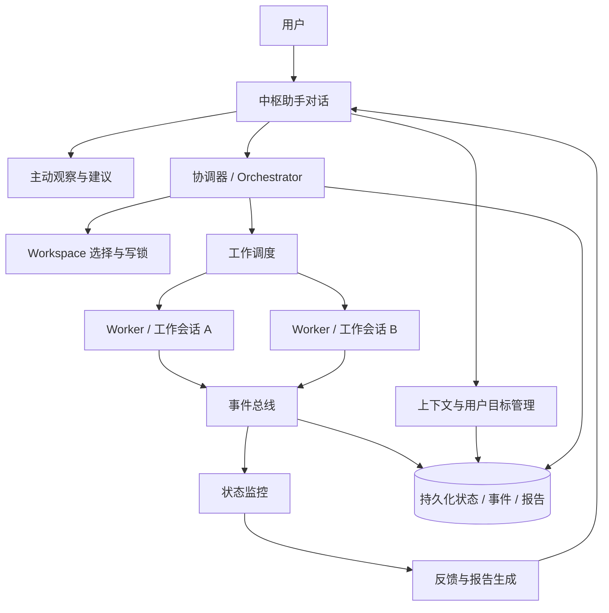

# 天工「中枢模式」设计稿（草案）

> 状态：概念设计草案，供产品与技术评审使用，**尚未进入实现排期**。
> 创建日期：2026-11-04
> 文档定位：只描述目标体验、边界、架构方向和待决问题；不把本方案写成已确认需求，也不替代后续 RFC / 实施设计。
> 约定：下文用“中枢助手”指用户面对的超级智能助手，用“工作会话 / Worker”指后台实际执行工作的会话或 Subagent。

---

## 0. 修订要点：为什么不是“任务中心”

早期表述容易把本模式理解成“任务管理面板”，这会削弱超级助手感。本设计稿采用以下定位：

> **以助手为入口，以用户目标为语义核心，以任务为后台执行机制。**

需要区分三个层次：

| 层次 | 核心对象 | 用户是否直接感知 | 说明 |
| --- | --- | --- | --- |
| 用户关系层 | 中枢助手 | 强感知 | 一个持续存在、理解上下文、主动观察、能协调后台工作的智能伙伴 |
| 意图与目标层 | 用户想达成什么 | 强感知 | 用户自然语言表达的目标、约束、优先级、当前关注点 |
| 执行层 | 任务、子任务、Workspace、工作会话、事件 | 弱感知 | 系统用于可靠执行、追踪、验证和汇报的内部机制 |

因此：

- 用户默认不是“创建任务”，而是“告诉天工想完成什么”；
- 用户默认不面对 Session 列表和任务看板，而面对一个持续对话；
- 后台仍然必须有任务、事件和状态机，否则多 Workspace、多 Agent、失败恢复和可靠反馈无法成立；
- 任务不应成为产品的第一层交互对象，只应在用户主动要求或发生异常时按需展开。

一句话总结：

> **天工中枢不是任务管理器，而是一个持续观察用户工作、理解用户意图、协调后台执行并在关键时刻反馈的个人超级助手。**

---

## 1. 背景与产品动机

当前天工以会话列表和单会话工作区为主要导航形态。用户需要感知“我在哪个会话中工作”、手动切换会话，并在会话内与 Agent 协作。

这对明确、局部、一次性的任务有效，但不完全符合一种更自然的想象：

> 用户面前始终只有一个智能助手。用户不需要关心它背后开了多少会话、用了多少 Agent、切换了哪个 Workspace；只需要表达目标，助手自行理解、安排、观察、协调，并在合适时机主动汇报。

这个体验更接近一个持续在场的个人超级助手：

- 持续在场；
- 理解上下文；
- 能主动提醒；
- 能协调后台能力；
- 不把内部工作机制暴露给用户；
- 用户以自然语言与它交流；
- 它可靠地反馈“发生了什么、完成了什么、还需要什么决定”。

但工程上必须避免把“像超级助手”误做成“一个什么都能直接做的大 Agent”。本方案的关键边界是：

> **中枢助手是控制面和交互面，不直接执行具体工作；具体工作由绑定到 Workspace 的后台工作会话或 Agent 完成。**

---

## 2. 目标、非目标与成功标准

### 2.1 产品目标

1. 提供一个新的桌面交互模式：隐藏左侧 Session 列表，进入单一中枢对话。
2. 建立一个长期存在的中枢助手身份，承载问候、上下文理解、主动建议、任务协调和结果汇报。
3. 用户只表达目标，不主动管理后台会话、Agent 和任务。
4. 中枢助手可针对某个或多个 Workspace 发起、恢复或协调工作会话。
5. 中枢助手不直接修改文件、执行命令或完成具体工作。
6. 工作会话通过事件把开始、进展、阻塞、审批、完成和失败反馈给中枢助手。
7. 中枢助手根据反馈策略，向用户发送单条即时反馈或阶段性汇总报告。
8. 用户激活天工时，中枢助手可主动问候，并基于上下文猜测用户可能要进行的工作，给出合适建议。
9. 保留可追溯性：需要时用户可以查看后台工作状态、原始工作会话、验证证据和报告。

### 2.2 非目标

第一阶段或非核心范围内暂不要求：

- 不做拟人化语音、全息界面或电影式视觉拟真；
- 不让中枢助手直接执行任何工具型工作；
- 不删除现有 Session 体系，不破坏普通模式；
- 不把本模式设计成通用项目管理系统；
- 不默认让模型凭推测自动执行高风险操作；
- 不在首期引入外部日历、邮件、生产环境发布等高风险集成；
- 不以“任务列表是否丰富”作为体验成功标准。

### 2.3 成功标准

本设计进入实现阶段前，至少应能用以下问题验证方向是否正确：

1. 用户是否能只用一个对话入口完成跨 Workspace 的目标表达？
2. 用户是否不必理解 Session、Subagent、Task ID 等内部概念？
3. 中枢助手是否始终不直接执行文件或命令类工作？
4. 后台任务完成时，用户是否能收到基于真实事件和验证证据的反馈？
5. 用户离开再回来后，中枢助手是否能准确汇报期间发生的变化？
6. 主动建议是否能说明依据，并且不会演变成频繁打扰？
7. 同一 Workspace 的并发修改是否受控？
8. 高风险操作是否仍然由用户掌握最后确认权？
9. 用户能否随时从“助手视图”深入到底层工作视图进行复核？
10. 关闭中枢模式后，普通模式与既有会话是否不受影响？

---

## 3. 核心概念与术语

| 术语 | 定义 | 用户可见程度 |
| --- | --- | --- |
| 中枢模式 | 隐藏左侧 Session 列表、以单一助手对话为入口的桌面模式 | 可见，产品模式名 |
| 中枢助手 | 用户持续对话的超级助手，负责理解、协调、观察、汇报 | 强可见 |
| 用户目标 | 用户用自然语言表达的意图及约束，是用户侧语义核心 | 强可见 |
| 关注事项 | 助手认为当前值得用户知道的进行中事项，用户侧对后台任务的轻表达 | 弱可见 |
| 后台工作 | 系统内部对执行单元的总称，不要求用户直接操作 | 按需可见 |
| Task / Subtask | 执行层数据结构，用于调度、状态、依赖和验证 | 默认隐藏 |
| Workspace | 任务绑定的工作区，包含路径、能力和权限边界 | 按需可见 |
| 工作会话 / Worker | 实际执行任务的会话、Subagent 或后台 Agent | 默认隐藏，复核时可见 |
| 事件 | 工作会话产生的结构化状态变化 | 默认隐藏 |
| 报告 | 中枢助手基于事件、证据和产物生成的用户可读汇总 | 可见 |

---

## 4. 总体体验

### 4.1 进入与退出模式

进入方式候选：

- 顶部模式切换；
- 快捷键，如 `Cmd/Ctrl + Shift + J`；
- 设置中指定启动默认进入；
- 未来可由全局唤醒入口进入。

进入后：

- 左侧 Session 列表隐藏；
- 主区域呈现单一中枢对话；
- 顶部保留模式、轻量状态和设置入口；
- 原 Session 和 Workspace 不清空、不迁移、不删除；
- 普通模式仍可从设置或模式切换恢复。

退出后：

- 正在运行的后台工作不因切换 UI 模式而取消；
- 中枢对话和任务状态持久化；
- 用户再次进入时恢复上下文和未确认反馈。

### 4.2 激活问候

激活时不使用固定欢迎语，而是基于当前可验证上下文生成简短问候。

可用上下文：

- 当前时间；
- 最近使用 Workspace；
- 正在运行或等待确认的后台工作；
- 最近完成、失败、阻塞的事项；
- 用户此前明确表达的目标；
- 用户设置的反馈频率和建议偏好。

示例：

> 早上好，Hubert。
> 你离开期间有 3 个事项发生变化：支付服务分析已完成，桌面客户端构建仍失败，另有一个数据库迁移方案等待你确认。
> 如果你今天继续处理客户端问题，我建议先看构建失败报告。

没有上下文时：

> 你好，我是天工中枢。
> 你可以直接告诉我目标，我会判断需要哪个 Workspace、安排后台工作、跟踪进展，并在关键节点向你汇报。

约束：

- 问候必须简洁；
- 不把推测写成事实；
- 不一次罗列过多信息；
- 建议最多 1～3 条；
- 明确区分“我发现”“我推测”“我建议”“已完成”。

### 4.3 用户表达目标

用户不需要选择 Session，不需要创建任务，不需要指定 Agent。

例如：

> 帮我看看支付服务最近为什么这么慢。

中枢助手内部判断：

- 这是只读分析还是修复请求；
- 目标 Workspace 是否明确；
- 是否存在多个候选 Workspace；
- 是否需要拆分后台工作；
- 是否存在并发写入冲突；
- 风险级别是否允许自动安排；
- 哪些结果值得向用户汇报。

用户可能看到的回复：

> 我会先安排一次只读分析，不修改代码。主要看最近的超时日志、请求链路和慢查询；如果找到明确原因，我再给你修复建议。

这里用户感受到的是“我交代给了一个能干活的助手”，而不是“我提交了一个任务”。

### 4.4 助手视图与工作视图

#### 默认：助手视图

- 全屏对话；
- 问候；
- 当前上下文；
- 主动建议；
- 重要进展；
- 阻塞询问；
- 完成或失败报告；
- 一个轻量的“查看后台工作”入口。

示意：

```text
┌─────────────────────────────────────────────┐
│ 天工中枢                    [后台状态] [设置] │
├─────────────────────────────────────────────┤
│                                             │
│ 早上好，Hubert。                             │
│                                             │
│ 昨天你提到支付服务响应变慢。                 │
│ 我观察到 payment-service 最近有 3 次超时错误，│
│ 已经准备好一份初步分析。                     │
│                                             │
│ 另外，client-app 的构建仍然失败。             │
│ 要我先处理支付超时，还是先修复构建问题？       │
│                                             │
│                         [查看后台工作]        │
├─────────────────────────────────────────────┤
│ 你想让我做什么？                       [发送] │
└─────────────────────────────────────────────┘
```

#### 按需：工作视图

用户点击“查看后台工作”或发生阻塞时再进入：

- 正在处理的事项；
- 子工作与依赖；
- Workspace；
- 工作会话 / Agent；
- 事件时间线；
- 验证命令和结果；
- 产物；
- 原始 Session 入口；
- 暂停、恢复、取消、要求汇报等控制。

工作视图是抽屉、侧边面板或详情页，不恢复成左侧 Session 列表，也不应成为主导航。

---

## 5. 中枢助手的职责边界

这是本设计最重要的工程约束。

### 5.1 允许的能力

中枢助手可以：

- 读取中枢对话和长期偏好；
- 读取用户目标、关注事项和后台状态摘要；
- 读取 Workspace 基础信息和能力；
- 选择或建议 Workspace；
- 创建、拆分、暂停、恢复、取消后台工作；
- 创建或唤醒工作会话；
- 向工作会话发送补充指令；
- 订阅任务事件；
- 请求用户审批或补充信息；
- 生成用户可读的即时反馈和汇总报告；
- 根据失败事件重新规划或建议下一步；
- 发送系统通知或 Bot 推送。

### 5.2 禁止直接执行的能力

中枢助手本身不应直接：

- 读写或修改用户项目文件；
- 执行 Shell 命令；
- 操作数据库；
- 修改代码；
- 安装依赖；
- 创建 Git 提交；
- 删除文件；
- 发布、部署或迁移生产数据；
- 发送外部消息；
- 操作桌面应用或浏览器完成具体工作；
- 伪造验证结果或声称任务完成。

### 5.3 权限隔离建议

不应只靠提示词约束，应由宿主在工具路由层建立独立白名单：

```text
中枢助手工具集：
- get_context
- list_workspaces
- inspect_workspace
- create_goal
- create_work_item
- dispatch_work_item
- pause_work_item
- resume_work_item
- cancel_work_item
- get_work_item_status
- get_work_item_events
- ask_user
- request_approval
- send_notification
- create_report

工作会话工具集：
- fs
- terminal
- command
- browser
- computer-use
- database
- coding
- test_runner
- plugin-specific tools
```

判断原则：

> 中枢助手可以“安排一次测试”，但不能“自己运行测试”；可以“读取测试已经通过的事件”，但不能“替 Worker 说测试通过”。

---

## 6. Workspace 选择与绑定

### 6.1 选择优先级

1. 用户当前明确指定的 Workspace；
2. 当前激活或最近使用的 Workspace；
3. 用户输入中出现的路径、项目名或模块名；
4. Workspace 描述、README、Git remote、文件索引匹配；
5. 最近处理过同类问题的 Workspace；
6. 多个候选时请求用户选择或提出拆分建议。

示例：

> 你说的“支付模块”在 `shop-backend` 和 `shop-web` 中都存在。
> 我建议先只读分析后端接口和数据库链路；如果你希望连前端支付页一起处理，我也可以拆成两个后台工作。

### 6.2 绑定信息

每个后台工作至少应记录：

```text
work_item
├── id
├── conversation_id
├── user_goal_id
├── parent_work_item_id
├── workspace_id
├── workspace_path
├── worker_session_id
├── worker_agent_id
├── status
├── risk_level
├── write_lock
├── created_at
├── updated_at
└── completion_criteria
```

这保证：

- 用户虽然看不到 Session 列表，后台仍能准确归属；
- 报告可以追溯验证证据；
- Workspace 并发写入可控；
- 中枢助手重启后能恢复状态；
- 用户可从报告进入原始工作会话。

### 6.3 冲突保护

建议默认策略：

- 同一 Workspace 同一时间最多一个写入型工作；
- 只读分析可并行；
- 多个写入工作按目标优先级排队；
- 用户可显式允许并行，但必须提示冲突风险；
- 排队状态应能被中枢助手解释为自然语言，而不是暴露锁细节。

用户侧表达：

> 我先让 `payment-service` 完成当前修复，再安排新的代码修改；同时可以继续做不修改文件的日志分析。

---

## 7. 用户目标与后台工作的映射

用户侧不创建“任务”，系统内部仍需要结构化执行计划。

### 7.1 目标表达

用户目标可包含：

- 标题；
- 自然语言描述；
- 约束；
- 完成标准；
- 优先级；
- 风险级别；
- 相关 Workspace；
- 是否允许自动安排；
- 是否需要用户确认计划；
- 反馈偏好。

示例：

```json
{
  "title": "排查支付服务响应变慢",
  "description": "用户希望了解最近支付服务响应变慢的原因，并在发现明确问题时得到修复建议",
  "constraints": ["首轮不修改代码", "优先使用已有日志和测试"],
  "completion_criteria": ["形成原因分析", "给出可复核证据", "如有明确修复方案则说明风险"],
  "risk_level": "low",
  "auto_dispatch": true
}
```

### 7.2 后台工作计划

```json
{
  "goal_id": "goal_xxx",
  "work_items": [
    {
      "title": "检查最近超时日志",
      "type": "analysis",
      "workspace": "payment-service",
      "depends_on": []
    },
    {
      "title": "检查数据库慢查询",
      "type": "analysis",
      "workspace": "payment-service",
      "depends_on": []
    },
    {
      "title": "形成原因分析与修复建议",
      "type": "synthesis",
      "depends_on": ["检查最近超时日志", "检查数据库慢查询"]
    }
  ]
}
```

“合成 / 汇总”是否由中枢助手自己完成需要进一步界定：如果它只基于事件和报告做语言组织，不调用工作型工具，可以视为控制面能力；如果需要读取文件、运行分析工具，则仍应由 Worker 完成。

---

## 8. 状态机与事件

### 8.1 后台工作状态

```text
draft
  ↓
planned
  ↓
queued
  ↓
running
  ├── waiting_user
  ├── waiting_resource
  ├── blocked
  ├── paused
  ├── failed
  └── completed
```

状态说明：

| 状态 | 含义 |
| --- | --- |
| `draft` | 中枢助手已理解目标，尚未正式安排 |
| `planned` | 已形成执行计划，等待调度 |
| `queued` | 已提交，等待 Workspace 或 Agent 可用 |
| `running` | Worker 正在执行 |
| `waiting_user` | 需要用户做决定、审批或补充信息 |
| `waiting_resource` | 等待外部资源、依赖、登录态或其他工作释放 |
| `blocked` | 已无法继续，需要中枢助手判断或汇报 |
| `paused` | 用户或系统暂停 |
| `failed` | 执行失败且自动恢复未解决 |
| `completed` | 完成条件满足且有证据 |

### 8.2 事件类型

```text
work_item.created
work_item.started
work_item.progress
work_item.phase_completed
work_item.waiting_user
work_item.waiting_resource
work_item.blocked
work_item.failed
work_item.completed
work_item.cancelled
workspace.locked
workspace.unlocked
approval.required
artifact.created
verification.completed
report.ready
```

### 8.3 事件结构示例

```json
{
  "event_id": "evt_xxx",
  "event_type": "work_item.completed",
  "work_item_id": "work_xxx",
  "workspace_id": "workspace_xxx",
  "worker_session_id": "session_xxx",
  "timestamp": "2026-11-04T17:00:00+08:00",
  "severity": "normal",
  "requires_user_action": false,
  "payload": {
    "summary": "已完成支付超时日志分析",
    "artifacts": [
      "/abs/path/to/report.md"
    ],
    "verification": [
      {
        "name": "日志时间范围检查",
        "passed": true,
        "evidence": "已覆盖 2026-11-01 至 2026-11-04"
      }
    ],
    "risks": [
      "生产日志尚未接入，当前结论基于 staging 日志"
    ]
  }
}
```

### 8.4 事件处理链路

```text
Worker 产生事件
  → 事件总线持久化
  → 中枢助手订阅
  → 判断是否需要用户可见反馈
  → 立即通知 / 延迟汇总 / 静默记录
  → 更新中枢对话和关注事项
```

事件必须持久化。中枢助手重启、桌面窗口关闭、普通模式切换或模型上下文压缩，都不应成为状态丢失的理由。

---

## 9. 反馈机制

### 9.1 单条即时反馈

适合：

- 完成；
- 失败；
- 阻塞；
- 需要用户审批；
- 发现高风险；
- 长时间无进展；
- 用户要求“现在汇报”。

示例：

> `payment-service` 的日志分析已完成。
> 结论：超时集中在数据库连接池等待。
> 证据：最近 3 天的 staging 日志和连接池指标。
> 我没有修改代码。是否让我安排一个修复方案？

### 9.2 汇总报告

适合：

- 一个用户目标拆成多个后台工作；
- 多个 Workspace 共同完成一个目标；
- 用户离开一段时间；
- 一批后台工作全部结束；
- 用户设置了安静 / 标准反馈策略。

示例：

> 登录功能相关工作已完成。
>
> **已完成**
> - 后端新增登录接口；
> - 前端接入登录状态；
> - 补充 Token 过期处理；
> - 补充接口和组件测试。
>
> **验证**
> - 后端测试通过；
> - 前端类型检查通过；
> - 构建成功。
>
> **仍需你决定**
> - 是否启用第三方 OAuth；
> - 生产环境密钥尚未配置。

### 9.3 反馈策略

| 策略 | 通知内容 |
| --- | --- |
| 安静 | 完成、失败、阻塞、需要审批 |
| 标准 | 安静模式内容 + 开始、阶段完成、关键发现、长等待 |
| 详细 | 标准模式内容 + 计划、Worker 分配、各阶段事件、验证命令、风险记录 |

默认建议“标准”。

### 9.4 汇报可靠性

中枢助手生成完成或失败反馈时必须基于：

- Worker 终态事件；
- 验证结果；
- 产物路径；
- 明确失败原因；
- 阻塞类型；
- 用户审批状态。

禁止：

- 根据“应该差不多完成了”推断完成；
- 把用户忽略的建议当作已批准；
- 把模型生成的计划当作执行证据；
- 在没有事件时声称某个 Workspace 已经开始工作。

---

## 10. 主动观察、猜测与建议

### 10.1 原则

中枢助手可以主动猜测用户将要进行的工作，但必须遵守：

1. 猜测只是建议，不等同于事实；
2. 建议必须说明依据；
3. 低风险只读工作可按设置自动安排；
4. 修改、删除、发布、外部消息等操作必须明确确认；
5. 不得因猜测直接触发高风险执行；
6. 用户忽略后进入冷却，不重复打扰。

示例：

> 你最近连续三次查看 `payment-service` 的超时日志。
> 我推测你可能正在排查支付请求超时。
> 我可以先安排一次只读分析，检查错误日志和请求链路。要开始吗？

### 10.2 建议来源

- 用户最近对话；
- 未完成目标；
- 失败或阻塞事项；
- Workspace Git 状态；
- 测试或构建失败；
- 重复出现的错误；
- 最近打开或引用的文件；
- 后台工作依赖；
- 长时间等待或长时间无事件；
- 用户长期偏好；
- 用户显式设置的关注 Workspace。

### 10.3 建议类型

- 后续工作建议；
- 风险建议；
- 依赖建议；
- 任务收尾建议；
- 异常停止重试建议；
- 恢复上下文建议；
- 每日 / 每次激活摘要建议。

### 10.4 频率控制

- 每次激活最多 1～3 条主动建议；
- 同一依据只提醒一次；
- 用户忽略后设置冷却时间；
- 只有出现新证据或状态变化才再次提示；
- 用户可关闭某类建议；
- 反馈策略为“安静”时，不主动推送非关键建议。

---

## 11. 超级助手感的来源

本模式的“超级助手感”不来自任务面板，而来自以下能力组合：

1. **持续在场**：用户回来时知道离开期间发生了什么。
2. **上下文连续**：能理解“那个问题”“继续昨天的事”“先别动生产环境”。
3. **主动观察**：发现异常、失败、等待和机会，而不是只等提问。
4. **自然表达**：用户说目标，不说 Task、Session、Agent 参数。
5. **自动协调**：自行选择 Workspace、安排 Worker、处理依赖。
6. **适时沉默**：不把每个工具步骤都推给用户。
7. **关键汇报**：在阻塞、完成、失败、风险、需要决定时出现。
8. **可解释建议**：说明为什么认为用户可能需要某个操作。
9. **稳定边界**：不擅自越权、不伪造完成、不在无证据时推断。
10. **可复核**：用户想看细节时，能进入事件、证据和原始会话。

---

## 12. 架构草图



### 12.1 逻辑模块

| 模块 | 职责 |
| --- | --- |
| 中枢对话 | 用户唯一交互入口，承载助手身份和上下文 |
| 上下文管理 | 当前目标、用户偏好、最近事件、长期记忆摘要 |
| 意图解释 | 把自然语言转成目标、约束、风险级别和完成标准 |
| 主动观察 | 根据状态变化、异常和偏好生成建议 |
| Workspace 解析 | 识别候选 Workspace，处理歧义和写入锁 |
| 协调器 | 决定是否安排、如何拆分、依赖、排队、暂停、恢复、取消 |
| 工作调度 | 创建 / 唤醒 Worker Session 或 Subagent，绑定 Workspace |
| 事件总线 | 持久化并分发所有后台工作事件 |
| 报告生成 | 基于事件和证据生成单条反馈或汇总报告 |
| 权限网关 | 强制区分中枢助手工具集与 Worker 工具集 |
| 工作视图 | 按需展示后台状态、时间线、验证证据和原始会话 |

### 12.2 与现有天工能力的关系

- **Session**：仍是执行和消息持久化基础，但不再作为中枢模式的第一层导航。
- **Subagent**：可作为 Worker 的实现方式之一；其任务、事件、完成回报可接入事件总线。
- **Workspace**：继续作为文件、命令和权限边界的权威来源。
- **插件 / 工具**：由 Worker 调用；中枢助手只调用协调类工具。
- **Coding / Checkpoint / Review**：适用于 Worker 内部开发流程，结果通过事件回传。
- **Memory**：可为中枢助手提供长期偏好和历史目标，但不能替代事件存储。
- **Scheduler / Bot / 通知**：可作为未来主动触达和远程汇报通道。

---

## 13. 数据模型草案

以下只是概念字段，不代表最终数据库结构。

### 13.1 中枢对话

```text
central_conversation
- id
- user_id
- mode
- assistant_profile_id
- preferences
- created_at
- last_active_at
```

### 13.2 用户目标

```text
user_goal
- id
- conversation_id
- title
- description
- constraints
- completion_criteria
- priority
- risk_level
- status
- created_at
- updated_at
```

### 13.3 后台工作

```text
work_item
- id
- goal_id
- parent_work_item_id
- workspace_id
- worker_session_id
- worker_agent_id
- title
- plan
- status
- write_lock
- retry_policy
- created_at
- updated_at
- completed_at
```

### 13.4 事件

```text
work_event
- id
- work_item_id
- type
- payload
- requires_user_action
- severity
- created_at
- acknowledged_at
```

### 13.5 报告

```text
report
- id
- conversation_id
- goal_id
- work_item_ids
- report_type
- summary
- verification
- artifacts
- risks
- decisions
- created_at
```

### 13.6 建议

```text
suggestion
- id
- conversation_id
- type
- reason
- proposed_action
- status
- cooldown_until
- expires_at
- created_at
```

---

## 14. 权限、安全与审计

### 14.1 风险分级

| 级别 | 示例 | 默认策略 |
| --- | --- | --- |
| 低 | 读取文件、分析日志、查看 Git 状态、运行本地测试、生成报告 | 可按设置自动安排 |
| 中 | 修改代码、创建分支、安装依赖、启动开发服务、修改本地配置 | 默认说明计划并确认，或依赖用户预授权 |
| 高 | 删除文件、生产部署、数据库迁移、强制推送、发送外部消息、付费、权限变化 | 最后一步必须明确确认 |

### 14.2 防止“猜测即执行”

界面和文案必须区分：

- **推测**：我推测你可能想……
- **建议**：我建议先……
- **计划**：我准备安排……
- **已提交**：后台工作已经交给……
- **进行中**：Worker 已产生开始事件……
- **完成**：Worker 报告完成，并通过以下验证……
- **失败**：Worker 报告失败，原因是……

### 14.3 审计要求

每次用户目标到后台工作的转换都应可追溯：

- 用户原始表达；
- 中枢助手解释出的目标和约束；
- 选择的 Workspace 及依据；
- 拆分出的后台工作；
- 派发到哪个 Worker Session；
- 关键事件；
- 用户审批记录；
- 验证证据；
- 最终报告。

---

## 15. 异常与边界情况

### 15.1 用户关闭天工

后台工作不应默认被取消。恢复时中枢助手汇报离开期间变化：

> 你离开期间有 3 个事项发生变化：1 个完成、1 个失败、1 个等待你的确认。

### 15.2 中枢助手重启

状态从事件存储和持久化数据恢复，不依赖模型上下文记忆。

### 15.3 Worker 长时间无反馈

超过阈值后：

1. 查询 Worker Session 是否仍活跃；
2. 若活跃但无进度，生成“无进展”提醒；
3. 若不活跃，把工作标记为异常等待；
4. 向用户说明已观察到的证据和可选下一步。

### 15.4 多目标互相影响

若一个后台工作失败导致其他依赖工作无法继续：

> 后端接口定义尚未完成，前端工作已自动暂停。我建议先处理后端问题，再恢复前端。

### 15.5 用户重复表达相同目标

应识别相似目标：

> 已经有一个支付超时分析在进行。你是想查看进度、补充要求，还是取消后重新安排？

### 15.6 Workspace 被外部修改

若检测到用户或外部进程改动，应提示风险：

> 当前 Workspace 在你上次离开后有未提交改动。我建议先让 Worker 读取现状，不覆盖这些改动。

### 15.7 中枢助手模型不可用

不能把“无法解释”伪装成“后台工作完成”。应降级为：

- 只展示结构化状态；
- 仍允许查看工作视图；
- 恢复后重新生成解释性汇报。

---

## 16. 与现有模式的兼容

| 维度 | 普通模式 | 中枢模式 |
| --- | --- | --- |
| 导航核心 | Session 列表 | 单一中枢对话 |
| 用户主要对象 | 当前会话 | 中枢助手与用户目标 |
| 工具过程 | 可直接在当前会话查看 | 默认收敛，按需进入工作视图 |
| 多会话 | 用户手动切换 | 后台协调，默认隐藏 |
| Workspace | 绑定到会话上下文 | 后台工作显式绑定 |
| 反馈 | 对话流中即时呈现 | 事件驱动，按策略汇报 |
| 适用场景 | 明确、局部、可全程协作的任务 | 长期、跨 Workspace、希望少打扰的协作 |

兼容原则：

- 不改变现有会话持久化格式的基本语义；
- 不把普通模式 Session 强行迁移成中枢数据；
- 中枢模式创建的 Worker Session 仍可在普通模式查看；
- 用户已有未提交改动、分支和工作区状态必须保留；
- 切换模式不取消活跃 turn 或后台工作，除非用户明确要求。

---

## 17. 分阶段落地建议

以下仅为未来评审时的拆分建议，不代表已排期。

### 阶段 0：概念确认

- 确认“助手入口 / 目标语义 / 任务执行机制”的三层定位；
- 确认中枢助手不得直接执行工作；
- 确认隐藏 Session 列表但不删除 Session；
- 确认首期反馈策略和权限边界。

### 阶段 1：最小可用体验

- 中枢模式 UI；
- 单一中枢对话；
- 激活问候；
- 用户手动指定或确认 Workspace；
- 创建 / 唤醒一个后台工作会话；
- 完成、失败、阻塞三类事件回报；
- 简单后台工作抽屉；
- 中枢助手工具白名单隔离。

首期不建议做复杂主动猜测。

### 阶段 2：可靠协调

- 自动识别 Workspace；
- 目标到后台工作的拆分；
- 多 Workspace 协调；
- 工作依赖与排队；
- Workspace 写入锁；
- 事件持久化；
- 汇总报告；
- 重启恢复。

### 阶段 3：主动智能

- 基于历史目标和状态生成建议；
- 识别重复错误和未收尾工作；
- 预测下一步；
- 每次激活摘要；
- 用户偏好学习；
- 反馈频率自适应。

### 阶段 4：完整中枢助手体验

- 全局快捷键；
- 系统通知；
- 语音交互；
- 多设备同步；
- 外部日历 / 邮件 / 消息集成；
- 更丰富的工作依赖图；
- 更强但受治理的自动化策略。

---

## 18. 开放问题

以下问题建议后续仔细研究后再决定：

1. 中枢模式的入口位置、快捷键和默认启动策略如何定义？
2. 中枢对话是全局唯一，还是每个用户配置 / 设备一个？
3. 中枢助手的长期记忆与 Workspace Memory 如何隔离和融合？
4. 主动问候是否允许读取日历、最近文件、应用状态？权限如何申请？
5. 哪些低风险只读工作可以默认自动安排？
6. 中风险修改工作是否默认先展示计划，还是允许“直接处理”？
7. 用户说“帮我处理一下”时，是否默认允许修改代码？
8. 中枢助手能否自行撰写汇总，还是所有汇总都必须由专门 Worker 产出？
9. 用户忽略建议后，冷却时间和再次提示条件如何定义？
10. 多 Workspace 写入冲突时，采用锁、隔离 worktree、补丁队列还是其他策略？
11. 事件总线放在宿主 Core、独立服务还是复用现有插件事件机制？
12. Worker 是否优先使用 Subagent，还是新建一种专用后台工作会话？
13. 中枢模式是否支持 CLI / Server / Bot 入口，还是首期只做桌面？
14. 模式切换时，普通模式活跃 turn 与中枢模式后台工作如何共存？
15. 报告中的验证证据如何与 Coding 插件的 checkpoint / review 结果统一？
16. 如何防止中枢助手通过“向 Worker 发补充指令”间接绕过工具白名单？
17. 用户能否指定“这个目标只允许我手动确认后才开始”？
18. 失败自动重试的边界、次数和成本上限如何控制？
19. 中枢助手生成的建议是否需要单独审计来源？
20. 如何评估该模式确实提升体验，而不是让用户觉得失去控制？

---

## 19. 建议的设计原则清单

后续实现或评审时，建议把以下原则作为检查表：

1. **中枢不是 Worker**：中枢助手负责理解、协调、观察和汇报，不直接做具体工作。
2. **隐藏 Session，不删除 Session**：Session 仍是后台执行实体，只是不作为主要导航。
3. **用户说目标，不说任务参数**：避免把产品做成任务管理表单。
4. **助手是入口，任务是机制**：任务模型存在于执行层，不抢占用户关系层。
5. **主动建议必须有依据**：每条建议都能回答“为什么现在告诉我”。
6. **完成状态必须可验证**：依赖事件、证据、产物和失败信息，不靠推断。
7. **适时沉默**：不把后台每一步都推给用户。
8. **关键节点必达**：阻塞、审批、完成、失败、高风险必须汇报。
9. **高风险最后确认**：删除、发布、生产、外部消息、权限变化由用户掌握最后决定权。
10. **可深入复核**：用户想看细节时，能进入工作视图、事件时间线和原始会话。
11. **模式切换无损**：不取消后台工作，不覆盖用户改动，不破坏普通模式。
12. **权限由系统强制**：不能只靠提示词要求中枢助手“别自己干活”。

---

## 20. 阶段性结论

推荐把本模式定义为：

> **天工中枢：一个以助手为持续入口、以用户目标为语义核心、以事件驱动后台工作为执行基础的个人超级智能助手模式。**

它应该给用户一种感觉：

> 我只需要告诉天工我想实现什么；天工理解我、记得上下文、会主动观察、会替我安排和协调后台工作，并在关键时刻给出可靠反馈。

而不应该给用户一种感觉：

> 我打开了一个更漂亮的会话列表，或者我必须先学会创建和管理任务。

本稿保留为设计草案，等待仔细研究后再决定：产品命名、首期范围、主动权限、事件架构、Subagent 复用方式，以及是否进入正式 RFC 和实现排期。
